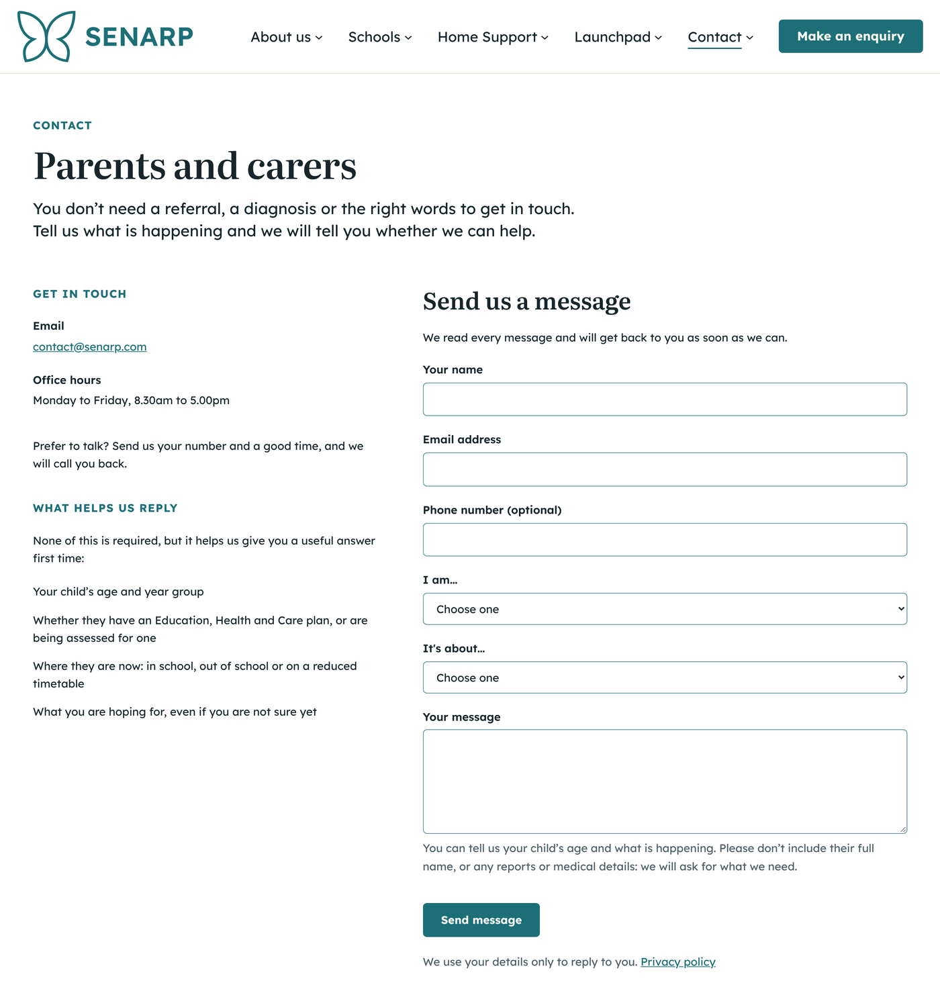
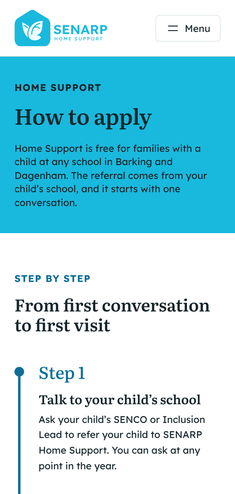
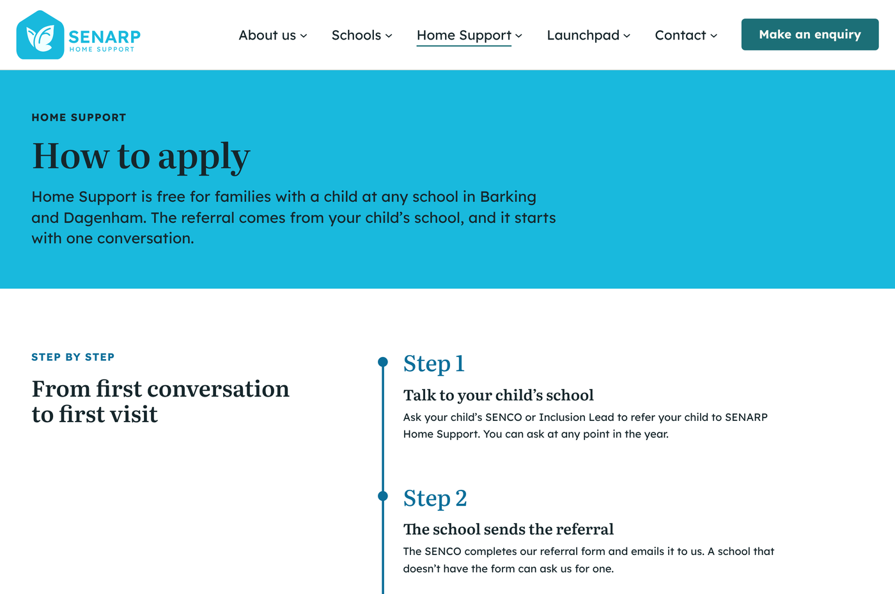

# SENARP Website

The website for SENARP, a specialist education organisation in east London for children and young adults with autism and other special educational needs and disabilities (SEND).

**Live site:** [senarp.com](https://senarp.com)

The code belongs to SENARP and is kept private, so this repository is a write-up of the project instead: what I built, how it works and the decisions behind it.

## The project

SENARP needed a new website to replace its old one. It had to explain SENARP's three services to families, schools and local authorities: SENARP Vibe Independent School in Dagenham, the Home Support programme delivered in partnership with the NHS and Barking and Dagenham Council, and Launchpad, its new provision for young adults aged 18 to 25. I led the project, from planning and design decisions through to launch, and I look after the site.

The site went live on 30 September 2026. It has 19 pages: a homepage, 15 pages across five sections (About us, Schools, Home Support, Launchpad and Contact) and three policy pages, all indexed by Google. The old senarp.co.uk address and 111 old page addresses redirect to the right place on the new site, so no old link ends on an error page.

## Screenshots

These only show pages without photographs, as the photos on the site are of children. The full site is at [senarp.com](https://senarp.com).

| Parents and carers contact page | Home Support page on a phone |
|---|---|
|  |  |

## What I built

### A custom WordPress block theme

- Built as a WordPress block theme, with the page templates, header and footer written as block markup
- A design system in `theme.json`: SENARP's colour palette, two self-hosted fonts and four text sizes, so every page stays consistent.
- Each of the three services has its own colour and logo, and its pages switch to them automatically, so the whole site keeps one layout without separate templates for each section
- 14 custom block styles for the cards, buttons and bands used across the site
- A testimonial slideshow, scroll and count-up animations, and an office map that only loads after consent

### Easy for staff to edit

- Staff change words, photos and links in the WordPress editor without touching any code
- The editor is locked to SENARP's own colours and text sizes, so pages can't drift off-brand or become hard to read
- The main section pages can't be deleted by accident, and menus SENARP doesn't use are hidden to keep the admin area simple
- A plain English handover guide explains everyday jobs, accounts, backups, updates and how to read the website's visitor numbers

### Enquiry forms and a dashboard

- Four contact pages (general, parents and carers, local authorities and ARP Consulting for mainstream schools), sharing one enquiry form
- Enquiries are emailed straight to SENARP's team. The website doesn't keep a copy, apart from holding a message for a short time if the email fails to send
- A limit on repeated sends from the same visitor to stop spam
- A custom "Website enquiries" box on the admin dashboard showing how many real enquiries came in each month (test sends are left out), and flagging if any emails failed to send

### Privacy, accessibility and SEO

- A cookie banner asks visitors before Google Analytics or the map is used, and nothing loads until they agree. How long data is kept was agreed with SENARP's Data Protection Officer.
- Google Analytics 4 counts a sent enquiry as a conversion without sending any of the form's contents
- Colour contrast measured against WCAG 2.2 AA, as the audience includes autistic children and their families
- A clear keyboard focus outline on every link and button, animations that respect the visitor's reduced motion setting, and pause controls for anything that moves
- After a form is sent, screen readers are taken straight to the confirmation message, and the count-up figures are only read out once
- Safeguarding rules for photographs: alt text describes the setting, never the child, and no child's face appears next to a testimonial
- A page title and description written for every page, a sitemap, and the site registered with Google Search Console and Bing

### Security and upkeep

- Two-factor login for anyone who can log in, with limits on login attempts
- The live site's settings hardened so errors are never shown to visitors and code can't be edited from the admin area
- A monthly routine of backing up, then updating WordPress and its plugins, written into the handover guide

## Problems I solved

- Enquiries weren't showing in Google Analytics. The form sends without reloading the page, so Analytics' built-in form tracking never recorded anything. I added a custom event that fires only once a message has actually been sent, and checked it on a real phone.
- The enquiry count was wrong. The form's own dashboard count included test messages, so it showed far more enquiries than SENARP really had. I replaced it with my own count that leaves tests out.
- False "email failed" alerts. Some enquiries were flagged as failed even though they arrived, because the email service sometimes took longer than WordPress waited. I gave it a longer timeout, only for that service.
- Keeping the design safe after handover. Whoever looks after the site next won't be technical, so I locked the colours and text sizes, protected the section pages and simplified the admin area, then wrote the handover guide around what is safe to change.
- A side effect of switching off unused features. Turning off WordPress features SENARP doesn't need also broke the sitemap Google reads, so I added an exception to keep it working.

## Built with

WordPress (block theme, `theme.json`), PHP, HTML, CSS, JavaScript, MySQL, Git and GitHub, Google Analytics 4, Google Search Console

**Armaan Khan** | [LinkedIn](https://www.linkedin.com/in/armaan-khan-6a6447189)
